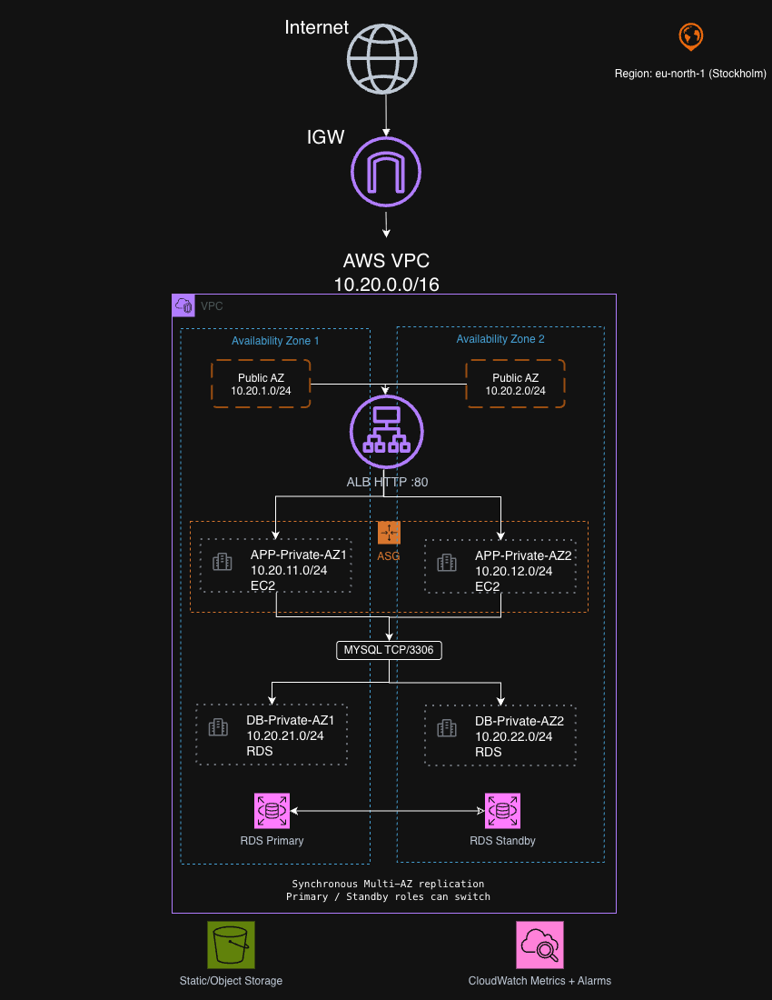

# AWS High Availability Web Application

A production-style AWS infrastructure project focused on high availability, fault tolerance, scalability, security, and monitoring.

The environment was built across multiple Availability Zones using an Application Load Balancer, EC2 Auto Scaling, private application subnets, Multi-AZ RDS, S3, and CloudWatch.

## Business Challenge

The goal was to design a web application infrastructure that could:

- Remain available if an EC2 instance fails
- Distribute traffic across multiple application servers
- Automatically scale based on load
- Keep application servers and the database private
- Survive a database Availability Zone failure
- Provide centralized monitoring and alerting
- Separate the web, application, and database layers using network and security boundaries

The architecture was also tested through controlled failure scenarios instead of only verifying that resources were successfully deployed.

## Architecture

The architecture spans two Availability Zones in the AWS eu-north-1 region. The Application Load Balancer is internet-facing across public subnets, while the EC2 application tier and RDS database tier remain in private subnets.

EC2 instances are managed by an Auto Scaling Group across both Availability Zones. RDS uses Multi-AZ deployment with synchronous replication between a primary and standby instance.

## Design Decisions & Security

The infrastructure was separated into public, application, and database tiers across two Availability Zones.

- Only the Application Load Balancer is internet-facing.
- EC2 application instances run in private subnets and do not have public IP addresses.
- RDS runs in dedicated private database subnets.
- The ALB accepts HTTP traffic on port 80 from the internet.
- EC2 instances accept HTTP traffic on port 80 only from the ALB security group.
- RDS accepts MySQL traffic on TCP/3306 only from the EC2 application security group.
- Separate route tables were used for the public, application, and database subnet tiers.
- No NAT Gateway was required for this project because the application bootstrap used software already available in the AMI.

Security groups reference other security groups instead of allowing broad IP ranges between application tiers. This limits traffic to the components that actually need to communicate.
